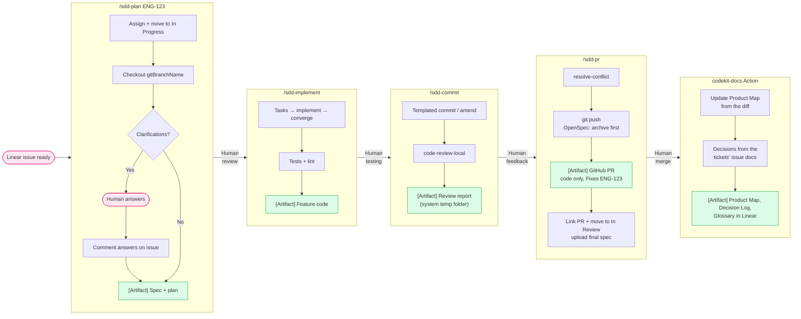
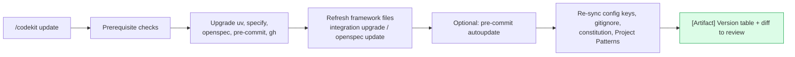
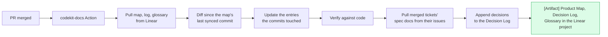
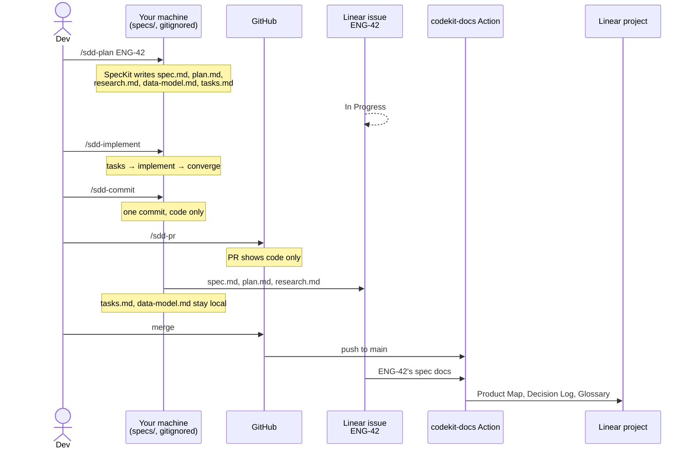

# Usage Flow

## Daily development

**Where things live** (with Linear on). Code goes in GitHub. Prose goes in Linear: with SpecKit or no framework, `specs/` stays local while you work and is gitignored; at PR time the issue gets the spec, plan, and research (tasks, contracts, and data models are build-time only, so they stay local). OpenSpec keeps `openspec/` in the repo by design. Without Linear (`codekit.linear = false`), specs stay committed, because the repo is their only home.

### Step by step

1. **`/sdd-plan ENG-123`.** You can also pass a Linear URL, `next` (pick from your assigned queue), a spec file path, or pasted text.
   - The issue is assigned to you and moved to the team's first *started* state.
   - The branch is Linear's `gitBranchName` (e.g. `jdoe/eng-123-add-login`), created from `origin/<base>`.
   - SpecKit: `specify → clarify → plan`. OpenSpec: `explore → propose`. With neither, a hand-written `specs/<id>/plan.md`.
   - Clarification answers are posted to the issue as one comment.
   - The plan is checked against current library docs (Context7).
   - The spec files stay local while you work, where SpecKit expects them.
2. **Review the plan.** Give feedback in chat until it's right.
3. **`/sdd-implement`.** SpecKit: `tasks → implement → converge` (repeating implement until converge finds nothing left, at most twice). OpenSpec: `apply`. Otherwise it follows the plan by hand. Tests and linters run at the end.
4. **Test it yourself.**
5. **`/sdd-commit`.** The first run creates the commit and later runs amend it. A local review follows, and its blockers are listed.
6. **`/sdd-pr`.** After a confirmation screen: rebase (OpenSpec changes are archived into `openspec/specs/`, amended into the one commit), push, then `gh pr create`. The PR shows code only. The issue gets the PR link, moves to *In Review* (not for `--draft`), and gets the spec, plan, and research through `linear-docs` (needs `LINEAR_API_KEY`), their copy of record since `specs/` isn't committed.
7. **After merge.** Linear's GitHub integration closes the issue through `Fixes ENG-123`. The `codekit-docs` Action (if installed) updates the Product Map, adds the ticket's decisions to the Decision Log, and appends new Glossary terms, all in Linear.

### Addressing PR feedback

Make the changes, then run `/sdd-commit` (amends) and `/sdd-pr` (sees the open PR, rebases, pushes with `--force-with-lease`, and refreshes the body).

## Project initialization

Init stops at the checks until `gh`, the Linear MCP and `uv` are all working. It then offers SpecKit, OpenSpec, or none, and installs and initializes whichever you choose. Picked none and want a framework later? Rerun `/codekit init`. Everything it already set up is skipped.

## Keeping current

Run `/codekit update` after updating the plugin, or periodically. The constitution and OpenSpec config are only ever **appended to**: a principle added in a newer codekit release is offered, and your existing ones are never reworded.

### Product docs

The app's **Product Map**, **Decision Log**, and **Glossary** live in its Linear project, not the repo, so PMs can read them, ask Linear Agent about the app (including "how hard is X?"), and file tickets in one place.

- **When:** after every merge, through the Action that `/codekit init` installs. Only the entries the new commits touched change, so names stay stable and PMs can follow what moved. A merge with no user-facing change only moves the sync line.
- **Full rebuild:** from the Actions tab (**Run workflow** → **full**), or `/codekit docs --full` locally. Use it for the first build, or when the map seems off.
- **Locally:** `/codekit docs` does the same update, but shows the changes and asks before publishing.
- **Who edits what:** the map is generated, so fix the code or the Glossary, not the map. The Decision Log is append-only and for reference: it's AI-extracted, each entry links its ticket as the source, and nothing feeds it to an agent. The Glossary belongs to the team, so the update only appends terms to it.
- **Effort questions:** the map's Core entities (attributes, cardinality, states) and Interfaces (who consumes each) let Linear Agent place a request on an effort rung, listed at the top of the map. That's a starting point; a developer confirms it.

Setup and secrets: [SETUP.md § Product docs Action](SETUP.md#product-docs-action).

#### Example: one feature with SpecKit

Ticket **ENG-42**, *"Customers can cancel an order before it ships."*

What changes in the Linear project after the merge:

| Document | Change |
|----------|--------|
| **Product Map** | Under *Orders*, a new capability **Cancel an order** (rule: only before it ships), and *Order* gains the state `cancelled`. Each line links the code. |
| **Decision Log** | An entry for ENG-42 from `research.md`, e.g. *Decided: cancel through a status change, not a delete. Why: refunds and reporting need the record.* It links ENG-42 as the source. |
| **Glossary** | A new term, **Cancellation**, with its code name and a blank Owner for the team to fill in. |

And where everything ends up:

| What | Where |
|------|-------|
| Code | GitHub (the PR) |
| `spec.md`, `plan.md`, `research.md` | Linear issue ENG-42 |
| `tasks.md`, `data-model.md`, `contracts/` | Nowhere: build-time only, gone with the local folder |
| Product Map, Decision Log, Glossary | Linear project |

### Dependencies

`/update-deps` (or `/update-deps <package> ...`) upgrades the project's own dependencies. On the base branch it first offers a `deps/<date>` branch. It applies every update that verifies green with the project's existing checks, shows a three-line card for each update that needs a code change, and offers the new features worth adopting as Linear issues. It finishes with a report and an offer to commit through `/sdd-commit`.

**Optional, pairs well:** [repokit](https://github.com/TheLampshady/repokit)'s `/dockit` generates `docs/FOUNDATIONS.md` and `docs/PRINCIPLES.md`. `sdd-implement` and `code-review-local` read those as the project's conventions, and `/codekit init` uses `docs/FOUNDATIONS.md`, when present, to build the constitution's Project Patterns. codekit works without them.

## Git configuration

| Key | Set by | Purpose |
|-----|--------|---------|
| `codekit.basebranch` | `/codekit init`, or offered on first detection | Target for diffs, rebases, and PRs |
| `codekit.linear` | `/codekit init` | Whether the repo uses Linear. With `false`, the loop works from files or pasted text, specs stay committed, and there are no Linear steps or product docs |
| `codekit.linear-team` | `/codekit init`, `sdd-plan`, `update-deps` | Scopes `sdd-plan next`; the team `update-deps` files issues in |
| `codekit.linear-project` | `/codekit init` | The app's Linear project ID (you create the project). Scopes `sdd-plan next`, holds the issues `update-deps` files, and holds the Product Map and Glossary |
| `codekit.reviewers` | `/codekit init` | GitHub handles passed to `gh pr create --reviewer` |

Set any key by hand with `git config --local codekit.<key> <value>`, or put it in `.config/.gitconfig` to share it.
