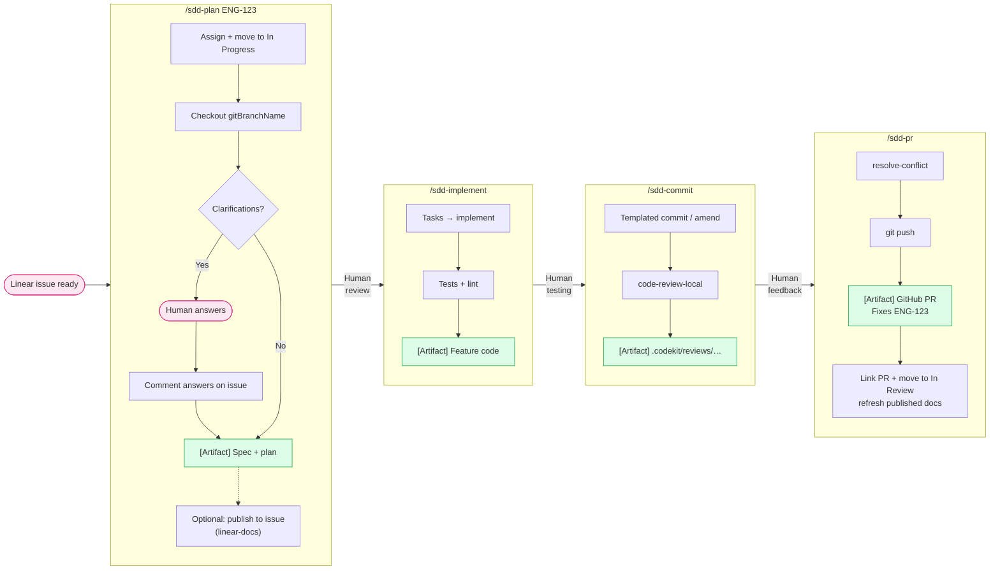
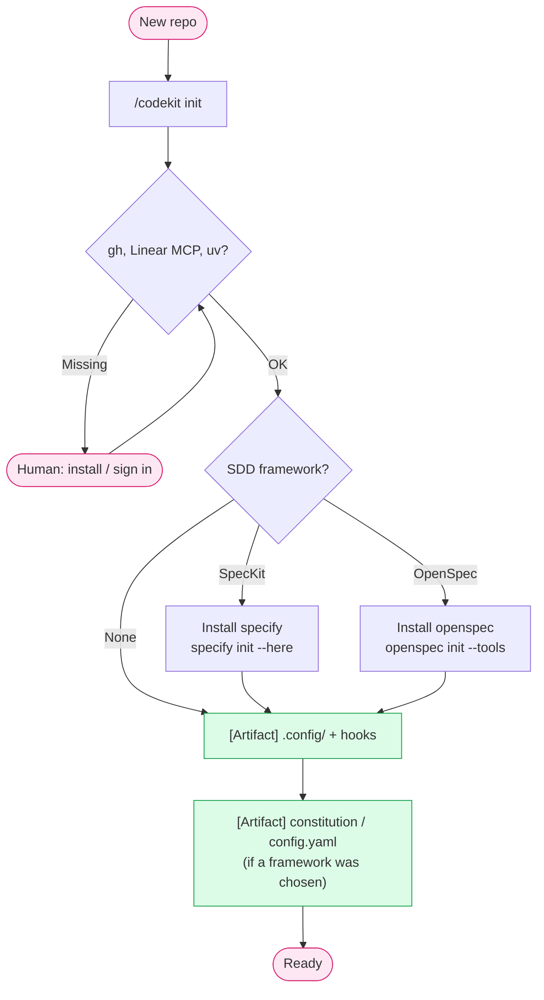
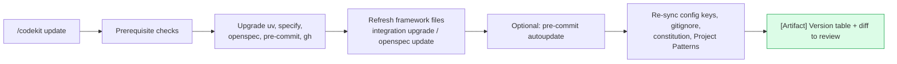

# Usage Flow

## Daily development

### Step by step

1. **`/sdd-plan ENG-123`.** You can also pass a Linear URL, `next` (pick from your assigned queue), a spec file path, or pasted text.
   - The issue is assigned to you and moved to the team's first *started* state.
   - The branch is Linear's `gitBranchName` (e.g. `jdoe/eng-123-add-login`), created from `origin/<base>`.
   - SpecKit: `specify → clarify → plan`. OpenSpec: `explore → propose`. With neither, a hand-written `specs/<id>/plan.md`.
   - Clarification answers are posted to the issue as one comment.
   - The plan is checked against current library docs (Context7).
   - Optionally, the spec and plan are published to the issue as Linear documents, through `linear-docs` (needs `LINEAR_API_KEY`).
2. **Review the plan.** Give feedback in chat until it's right.
3. **`/sdd-implement`.** SpecKit: `tasks → implement`. OpenSpec: `apply`. Otherwise it follows the plan by hand. Tests and linters run at the end.
4. **Test it yourself.**
5. **`/sdd-commit`.** The first run creates the commit and later runs amend it. A local review follows, and its blockers are listed.
6. **`/sdd-pr`.** After a confirmation screen: rebase, push, then `gh pr create`. The issue gets the PR link and moves to *In Review* (not for `--draft`). If the plan was published in step 1, the issue's documents are refreshed to match what shipped.
7. **After merge.** With OpenSpec, run `/opsx:archive <change-id>` to fold the spec deltas into `openspec/specs/`. Linear's GitHub integration closes the issue through `Fixes ENG-123`.

### Addressing PR feedback

Make the changes, then run `/sdd-commit` (amends) and `/sdd-pr` (sees the open PR, rebases, pushes with `--force-with-lease`, and refreshes the body).

## Project initialization

Init stops at the checks until `gh`, the Linear MCP and `uv` are all working. It then offers SpecKit, OpenSpec, or none, and installs and initializes whichever you choose. Picked none and want a framework later? Rerun `/codekit init`. Everything it already set up is skipped.

## Keeping current

Run `/codekit update` after updating the plugin, or periodically. The constitution and OpenSpec config are only ever **appended to**: a principle added in a newer codekit release is offered, and your existing ones are never reworded.

### Dependencies

`/update-deps` (or `/update-deps <package> ...`) upgrades the project's own dependencies. On the base branch it first offers a `deps/update-<date>` branch. It applies every update that verifies green with the project's existing checks, shows a three-line card for each update that needs a code change, and offers the new features worth adopting as Linear issues. It finishes with a report and an offer to commit through `/sdd-commit`.

**Optional, pairs well:** [repokit](https://github.com/TheLampshady/repokit)'s `/dockit` generates `docs/FOUNDATIONS.md` and `docs/PRINCIPLES.md`. `sdd-implement` and `code-review-local` read those as the project's conventions, and `/codekit init` uses `docs/FOUNDATIONS.md`, when present, to build the constitution's Project Patterns. codekit works without them.

## Git configuration

| Key | Set by | Purpose |
|-----|--------|---------|
| `codekit.basebranch` | `/codekit init`, or offered on first detection | Target for diffs, rebases, and PRs |
| `codekit.linear-team` | `/codekit init`, `sdd-plan`, `update-deps` | Scopes `sdd-plan next`; the team `update-deps` files issues in |
| `codekit.reviewers` | `/codekit init` | GitHub handles passed to `gh pr create --reviewer` |

Set any key by hand with `git config --local codekit.<key> <value>`, or put it in `.config/.gitconfig` to share it.
