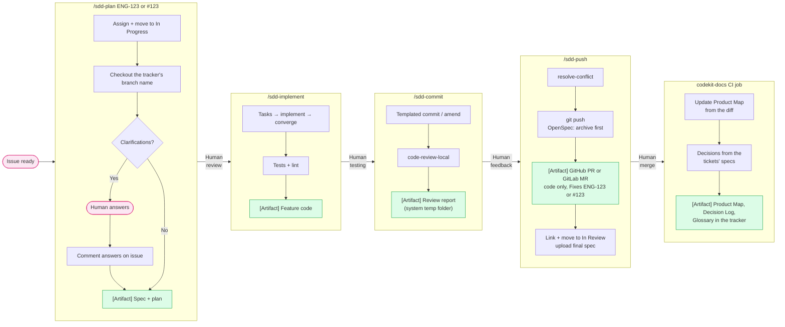
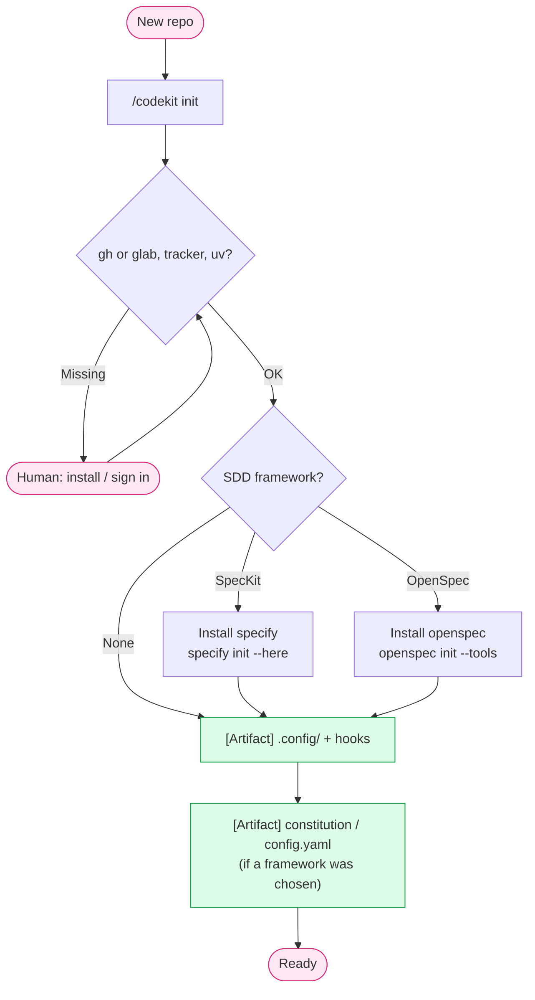
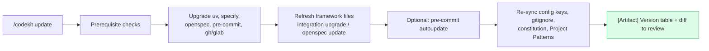
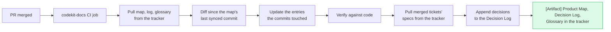
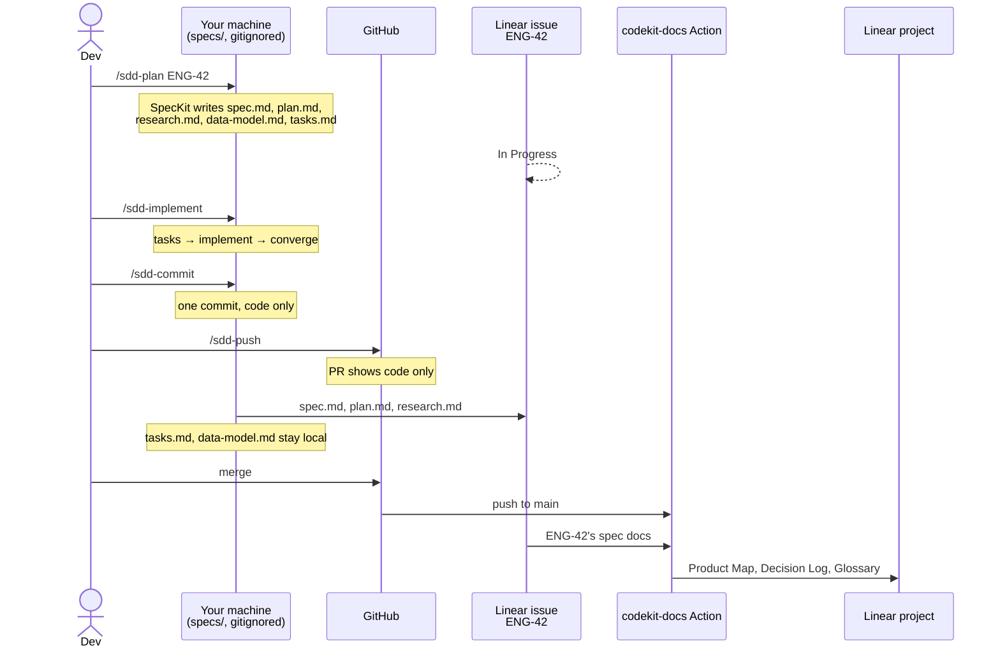

# Usage Flow

## Daily development

**Where things live** (with a tracker). Code goes in the repo, on GitHub or GitLab. Prose goes where the tickets are: with SpecKit or no framework, `specs/` stays local while you work and is gitignored; at PR time the tracker gets the spec, plan, and research (the Linear issue, or `specs/<folder>/` in the GitLab project's wiki). Tasks, contracts, and data models are build-time only, so they stay local. OpenSpec keeps `openspec/` in the repo by design. Without a tracker (`codekit.tracker = none`), specs stay committed, because the repo is their only home, and the project docs live in `docs/project/`.

### Step by step

1. **`/sdd-plan ENG-123`** (Linear) or **`/sdd-plan #123`** (GitLab). You can also pass an issue URL, `next` (pick from your assigned queue), a spec file path, or pasted text.
   - The issue is assigned to you and moved to *In Progress*: the Linear team's first *started* state, or the GitLab board's in-progress column.
   - The branch is Linear's `gitBranchName` (e.g. `jdoe/eng-123-add-login`), or the GitLab project's branch name (e.g. `123-add-login`), created from `origin/<base>`.
   - SpecKit: `specify → clarify → plan`. OpenSpec: `explore → propose`. With neither, a hand-written `specs/<id>/plan.md`.
   - Clarification answers are posted to the issue as one comment.
   - The plan is checked against current library docs (Context7).
   - The spec files stay local while you work, where SpecKit expects them.
2. **Review the plan.** Give feedback in chat until it's right.
3. **`/sdd-implement`.** SpecKit: `tasks → implement → converge` (repeating implement until converge finds nothing left, at most twice). OpenSpec: `apply`. Otherwise it follows the plan by hand. Tests and linters run at the end.
4. **Test it yourself.**
5. **`/sdd-commit`.** The first run creates the commit and later runs amend it. A local review follows, and its blockers are listed.
6. **`/sdd-push`.** It asks for the target branch only the first time, when `codekit.basebranch` isn't set, and saves it. Then, without stopping: rebase (OpenSpec changes are archived into `openspec/specs/`, amended into the one commit), push, then `gh pr create` or `glab mr create`. The PR shows code only. The issue gets linked, moves to *In Review* (not for `--draft`), and the tracker gets the spec, plan, and research, their copy of record since `specs/` isn't committed: through `linear-docs` (needs `LINEAR_API_KEY`), or through `wiki-docs` into the GitLab wiki.
7. **After merge.** `Fixes ENG-123` closes the issue through Linear's integration, and `Fixes #123` closes it in GitLab (when the merge request targets the default branch). The `codekit-docs` CI job (if installed) updates the Product Map, adds the ticket's decisions to the Decision Log, and appends new Glossary terms, all where the tickets live.

### Addressing PR feedback

Make the changes, then run `/sdd-commit` (amends) and `/sdd-push` (sees the open PR, rebases, pushes with `--force-with-lease`, and refreshes the body).

## Project initialization

Init first asks where the tickets live (Linear, GitLab issues, or none), then stops at the checks until the code host's CLI (`gh` or `glab`), `uv`, and with Linear the Linear MCP, are all working. It then offers SpecKit, OpenSpec, or none, and installs and initializes whichever you choose. Picked none and want a framework later? Rerun `/codekit init`. Everything it already set up is skipped.

## Keeping current

Run `/codekit update` after updating the plugin, or periodically. The constitution and OpenSpec config are only ever **appended to**: a principle added in a newer codekit release is offered, and your existing ones are never reworded.

### Project docs

The app's project docs, the **Product Map**, **Decision Log**, and **Glossary**, live where its tickets do, not in the repo: in its Linear project, where PMs can read them, ask Linear Agent about the app (including "how hard is X?"), and file tickets in one place, or in its GitLab project's wiki, next to the board.

- **When:** after every merge, through the CI job that `/codekit init` installs (a GitHub Action, or a GitLab CI job). Only the entries the new commits touched change, so names stay stable and PMs can follow what moved. A merge with no user-facing change only moves the sync line.
- **First build:** `/codekit init` offers it. Besides the map, it adds the decisions from specs already merged to the Decision Log, so none are lost when `specs/` stops being tracked.
- **Full rebuild:** GitHub: the Actions tab (**Run workflow** → **full**). GitLab: run a pipeline for the base branch with `CODEKIT_FULL=true`. Or `/project-docs --full` locally, when the map seems off.
- **Locally:** `/project-docs` does the same update, but shows the changes and asks before publishing.
- **Without a tracker:** the same three docs are files in `docs/project/`. `sdd-push` updates them inside each PR and amends them into its commit, so they're reviewed with the code. Commits pushed some other way are caught up by the next update, and a pre-push hook says when the docs are behind.
- **Google Drive copy:** with `codekit.drive` set, CI also copies the three docs to that Drive folder as Google Docs, for people who can't open the tracker or the repo. With a tracker, the `codekit-docs` job does it after publishing. Without one, the `codekit-drive` job does it after a merge changes `docs/project/`. It's one-way: edit the docs where they live, never in Drive. Setup: [SETUP.md § Google Drive copy](SETUP.md#google-drive-copy).
- **Who edits what:** the map is generated, so fix the code or the Glossary, not the map. The Decision Log is append-only and for reference: it's AI-extracted, each entry links its ticket as the source, and nothing feeds it to an agent. The Glossary belongs to the team, so the update only appends terms to it.
- **Effort questions:** the map's Core entities (attributes, cardinality, states) and Interfaces (who consumes each) let Linear Agent place a request on an effort rung, listed at the top of the map. That's a starting point; a developer confirms it.

Setup and secrets: [SETUP.md § Project docs](SETUP.md#project-docs).

#### Example: one feature with SpecKit and Linear

Ticket **ENG-42**, *"Customers can cancel an order before it ships."*

What changes in the Linear project after the merge:

| Document | Change |
|----------|--------|
| **Product Map** | Under *Orders*, a new capability **Cancel an order** (rule: only before it ships), and *Order* gains the state `cancelled`. Each line links the code. |
| **Decision Log** | An entry for ENG-42 from `research.md`, e.g. *Decided: cancel through a status change, not a delete. Why: refunds and reporting need the record.* It links ENG-42 as the source. |
| **Glossary** | A new term, **Cancellation**, with its code name and a blank Owner for the team to fill in. |

And where everything ends up:

| What | Where |
|------|-------|
| Code | GitHub (the PR) |
| `spec.md`, `plan.md`, `research.md` | Linear issue ENG-42 |
| `tasks.md`, `data-model.md`, `contracts/` | Nowhere: build-time only, gone with the local folder |
| Product Map, Decision Log, Glossary | Linear project |

With GitLab issues, the same ticket is **#42**: the branch is `42-cancel-an-order`, the merge request says `Fixes #42`, `spec.md`, `plan.md`, and `research.md` go to `specs/42-cancel-an-order/` in the project wiki, and the three project docs are pages at the wiki's root. The Decision Log entry links #42.

### Dependencies

`/update-deps` (or `/update-deps <package> ...`) upgrades the project's own dependencies. On the base branch it first offers a `deps/<date>` branch. It applies every update that verifies green with the project's existing checks, shows a three-line card for each update that needs a code change, and offers the new features worth adopting as issues in your tracker. It finishes with a report and an offer to commit through `/sdd-commit`.

**Optional, pairs well:** repokit's `/dockit` generates `docs/FOUNDATIONS.md` and `docs/PRINCIPLES.md`. `sdd-implement` and `code-review-local` read those as the project's conventions, and `/codekit init` uses `docs/FOUNDATIONS.md`, when present, to build the constitution's Project Patterns. codekit works without them.

## Git configuration

| Key | Set by | Purpose |
|-----|--------|---------|
| `codekit.basebranch` | `/codekit init`, or offered on first detection | Target for diffs, rebases, and PRs |
| `codekit.tracker` | `/codekit init` | Where the tickets live: `linear`, `gitlab`, or `none`. With `none`, the loop works from files or pasted text, specs stay committed, there are no tracker steps, and the project docs live in `docs/project/` |
| `codekit.team` | `/codekit init`, `sdd-plan`, `update-deps` | Linear only. Scopes `sdd-plan next`; the team `update-deps` files issues in |
| `codekit.project` | `/codekit init` | Linear only. The app's Linear project ID (you create the project). Scopes `sdd-plan next`, holds the issues `update-deps` files, and holds the Product Map and Glossary |
| `codekit.reviewers` | `/codekit init` | Usernames on the code host, passed to `gh pr create --reviewer` or `glab mr create --reviewer` |
| `codekit.drive` | `/codekit init` | Optional. A Google Drive folder ID. CI also copies the project docs there as Google Docs, for people who can't open the tracker or the repo |

The code host, the GitLab project, and the board's columns aren't settings: codekit reads them from the `origin` remote and the board each run.

Set any key by hand with `git config --local codekit.<key> <value>`, or put it in `.config/.gitconfig` to share it.
